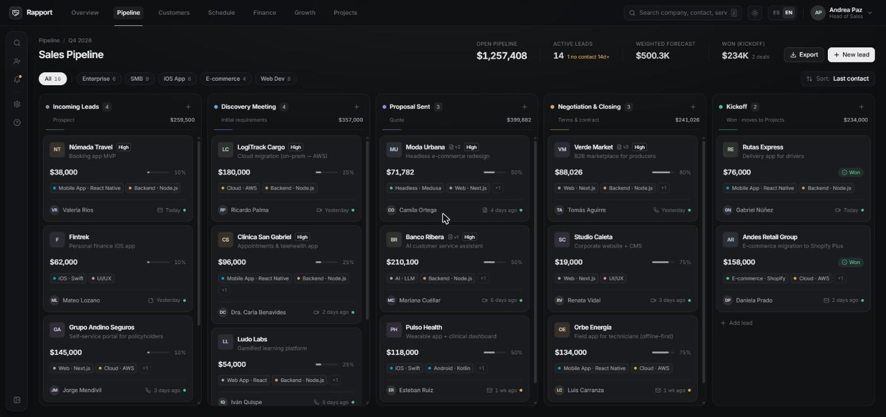
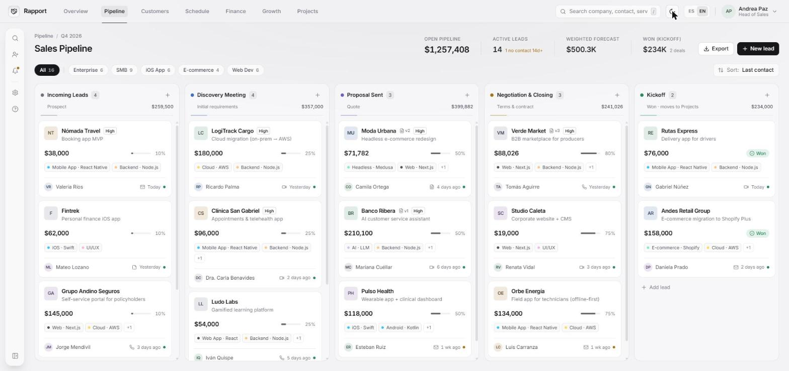
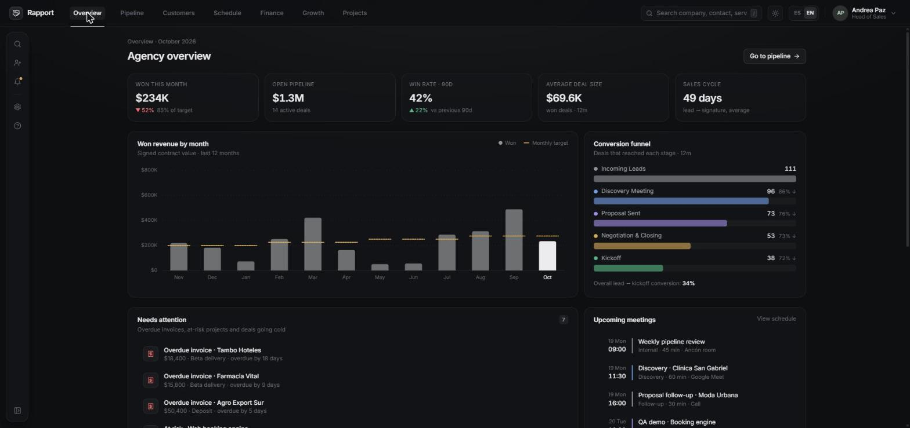
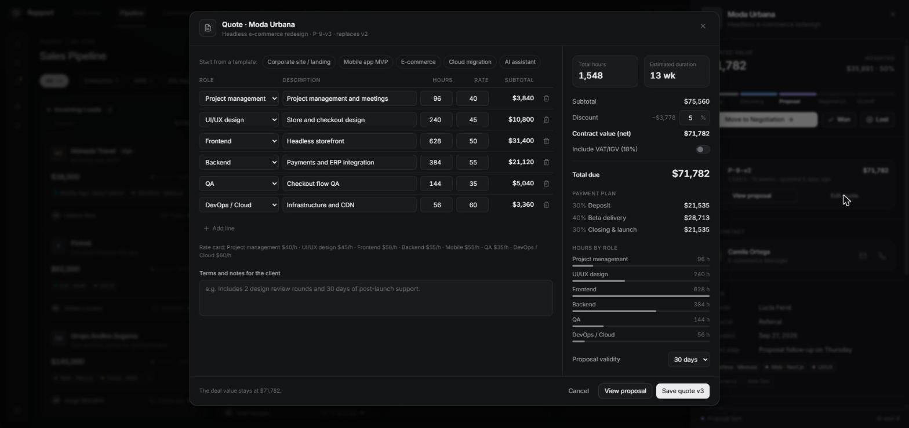
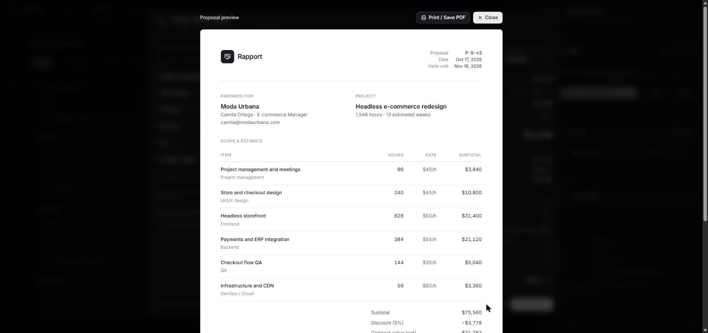
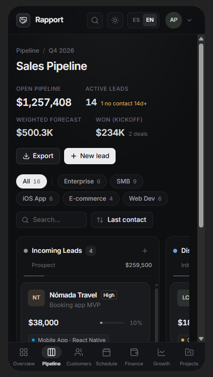

# Rapport — CRM para agencias (demo)

CRM y pipeline de ventas para una agencia de desarrollo web y apps móviles.
React 18 + TypeScript + Tailwind CSS v4 + Lucide React, sobre Vite. Sin librerías de estado ni de gráficos:
el store es Context + useReducer y los gráficos son SVG propios.

**Demo en vivo:** https://rapport-crm-six.vercel.app

```bash
npm install
npm run dev        # http://localhost:5173
npm run build      # typecheck + build de producción
```

## Módulos

| Vista | Qué muestra |
|---|---|
| Overview | KPIs del mes, ingresos vs meta (12 meses), embudo de conversión, alertas, próximas reuniones, ranking, actividad |
| Pipeline | Kanban con drag & drop, filtros por segmento, búsqueda, detalle de deal, alta de leads |
| Customers | Directorio ordenable (clientes y prospectos) con ficha: contactos, deals, proyectos, facturas, historial |
| Schedule | Calendario semanal, detalle de evento, próximos 7 días, follow-ups, alta de eventos |
| Finance | Cobrado / por cobrar / vencido, flujo de caja proyectado, cobranza por proyecto, tabla de facturas con acciones |
| Growth | Rendimiento por fuente, servicio y segmento, motivos de pérdida, tasa de cierre mensual, tiempo por etapa |
| Projects | Proyectos con fase, avance, salud, horas y hitos de pago 30/40/30 |

## Todo está conectado

- **Pasar a Projects** (deal en Kickoff) crea el proyecto con sus 3 hitos → aparece en Projects, Finance y Customers.
- Emitir una factura o registrar un pago actualiza Finance, Overview (alertas) y la ficha del cliente.
- Las alertas de Overview y los links entre vistas abren el deal, proyecto o cliente correspondiente.

## Estructura

```
src/
├─ App.tsx                 # Shell: navegación entre módulos con "foco", atajos, modal de lead, toasts
├─ store/AppStore.tsx      # Store global (Context + useReducer): deals, proyectos, eventos
├─ store/selectors.ts      # Estado derivado (facturas, vencidas, último contacto)
├─ data/                   # Seeds: deals, historial 12m (PRNG con semilla), clientes, proyectos, agenda
├─ views/                  # Una vista por pestaña
├─ components/
│  ├─ layout/              # TopNav, ToolSidebar
│  ├─ pipeline/            # Kanban, tarjetas, drawer, modal de lead
│  ├─ charts/              # BarChart (barras + meta + línea), HBarList
│  └─ ui/                  # Primitivas (Avatar, Button, Toast…) y piezas de página (Panel, Kpi, Drawer, Table)
└─ lib/format.ts           # Moneda, fechas, helpers
```

Atajos: `/` buscar · `N` nuevo lead · `Esc` cerrar.


## Modo claro / oscuro

Todos los colores son tokens CSS en `src/index.css`; el modo claro redefine los mismos tokens bajo `:root[data-theme="light"]`.
`useTheme` (`src/lib/theme.ts`) guarda la elección en `localStorage` y, si no hay, usa la preferencia del sistema.
Se cambia con el botón sol/luna del top nav o en Ajustes de la barra lateral.

## Funciones de la demo

- **Búsqueda global** (`Ctrl/⌘ K`): deals, clientes, proyectos, facturas y acciones, con teclado.
- **Notificaciones en vivo**: salen de las mismas alertas que Overview y abren el elemento.
- **Exportar CSV** del pipeline filtrado (descargar o copiar).
- **Marcar deal como perdido** con motivo: sale del pipeline y alimenta Growth, Overview y Customers.
- **Persistencia** en `localStorage` y **Restablecer datos de la demo** desde el menú de perfil.
- **Login de demo** (Cerrar sesión desde el menú de perfil).
- **Móvil**: barra de navegación inferior con las 7 vistas.

## Idiomas (ES / EN)

- Selector ES/EN en el top nav, en el menú de perfil, en Ajustes y en la búsqueda global (`Ctrl/⌘ K`).
- `src/lib/i18n.tsx`: `LangProvider` + `useT()`. El texto en español es la clave: `t('Pipeline abierto')`, con variables `t('Hace {n} días', { n })`.
- `src/i18n/en.ts`: diccionario inglés (UI + contenido de ejemplo) y patrones para textos con partes variables. Si falta una traducción se muestra el español, nunca una clave rota.
- Fechas y meses usan el locale activo (`es-PE` / `en-US`). La elección se guarda; la primera vez se usa el idioma del navegador.
- Para agregar un idioma: crea `src/i18n/<lang>.ts` con la misma forma y súmalo en `toEnglish`/`tr`.

## Cotizador

- Desde el detalle de un deal: **Cotizar** / **Editar cotización**.
- Partidas por rol (horas × tarifa del tarifario), 5 plantillas (web, MVP móvil, e-commerce, migración cloud, IA), descuento, IGV opcional, plan de pagos 30/40/30 y duración estimada.
- Cada guardado crea una nueva versión (`P-9-v3`), actualiza el valor del deal y queda en la actividad.
- **Ver propuesta** abre el documento comercial listo para **Imprimir / Guardar PDF** (`@media print` imprime solo la hoja).
- Lógica pura en `src/lib/quote.ts` (cubierta por tests).

## Tests y CI

```bash
npm test          # Vitest: store, selectores, cotizador, i18n, CSV
npm run typecheck # tsc --noEmit
```

`.github/workflows/ci.yml` corre typecheck + tests + build en cada push y pull request.

## Publicar en Vercel

1. Sube el proyecto a GitHub:
   ```bash
   git init && git add . && git commit -m "Rapport CRM"
   git branch -M main
   git remote add origin https://github.com/<tu-usuario>/rapport-crm.git
   git push -u origin main
   ```
2. En [vercel.com/new](https://vercel.com/new) importa el repo. Vercel detecta **Vite**: build `npm run build`, output `dist`. Deploy.
3. Cada push a `main` vuelve a desplegar; cada PR genera una URL de preview.

## Capturas

**Pipeline** (oscuro y claro)




**Overview**



**Cotizador y propuesta**




**Móvil**


